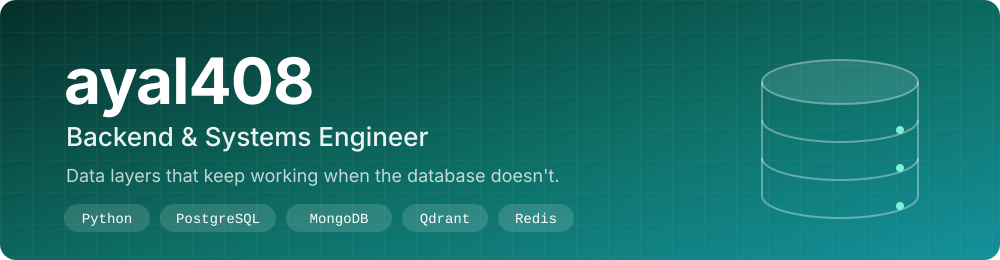

 

---

## About

Most outages start with a database doing something unexpected at 3am. I design
enterprise-grade backends with a clear plan for that moment: retries, caching,
multi-tenancy and audit trails built in from the start, not patched on per driver.

- **Focus now:** resilience patterns such as circuit breakers, retry with backoff,
  cache-aside layers and audit-trail observability.
- **In progress (private):** an Israeli SMB accounting and invoicing ERP on .NET 10 and
  React, built around Israeli tax-compliance workflows.
- **Also built:** a TypeScript web app for booking and managing treatment appointments.

## Featured projects

| Project | Problem it solves | Key features |
|---|---|---|
| [**krossdb**](https://github.com/ayal408/krossdb) `Python` | Application code tied to five different database drivers | One repository / Unit-of-Work interface over PostgreSQL, MySQL, SQLite, MongoDB and Qdrant. Circuit breakers, retry with backoff, cache-aside, multi-tenancy isolation |
| [**mailbrief**](https://github.com/ayal408/mailbrief) `Python` | Inbox overload, with no data leaving the machine | Local, rule-based mail assistant for Windows. No AI, no cloud, standard library only. Weekly Hebrew brief, trigger → conditions → actions engine, receipts to Excel with Bank of Israel rates, phishing detection, automatic Shabbat / Yom Tov pause |
| [**domix**](https://github.com/ayal408/domix) `Docker` | A complete client/server stack that starts with one command | Own auth service, Nginx in front, everything orchestrated with Docker Compose |

## Tech stack

<table>
  <tr>
    <td><b>Backend</b></td>
    <td></td>
  </tr>
  <tr>
    <td><b>Data</b></td>
    <td></td>
  </tr>
  <tr>
    <td><b>Infra &amp; tooling</b></td>
    <td></td>
  </tr>
  <tr>
    <td><b>Frontend</b></td>
    <td></td>
  </tr>
</table>

Also in the toolbox: async SQLAlchemy, Pydantic v2, Qdrant, structlog, pytest and Testcontainers.

## Activity

## Contact

